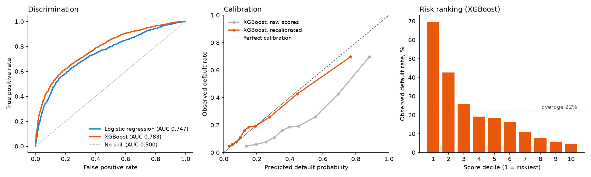

# credit-risk-validation

[](https://github.com/YusufErem/credit-risk-validation/actions/workflows/notebooks.yml)


**A credit-default model reviewed the way a model-risk team would review it.** Logistic regression (champion) and
XGBoost (challenger) are built on 30,000 credit-card clients, then tested for discrimination, calibration, risk
ranking, segment performance, population stability and explainability.



<sub>Test set, 6,000 clients. Drawn by [`docs/make_figure.py`](docs/make_figure.py).</sub>

## Results

| Metric (test set unless stated) | Logistic regression | XGBoost | Reference |
|---|---|---|---|
| ROC-AUC | 0.747 | **0.783** | 0.500 no skill |
| ROC-AUC, 5-fold CV on the training set | 0.761 ± 0.008 | **0.785 ± 0.007** | |
| Gini | 0.494 | **0.566** | |
| KS | 0.389 | **0.422** | |
| Brier score, raw | 0.193 | 0.179 | 0.172 no skill |
| Brier score, recalibrated | 0.144 | **0.135** | 0.172 no skill |
| Train–test AUC gap | **0.017** | 0.036 | |

## What the validation found

- **The challenger is better, and the gap is real.** XGBoost beats logistic regression by 0.036 AUC, with a 95%
  bootstrap interval of [0.027, 0.046]. Its train–test gap is also larger (0.036 against 0.017), so it needs closer
  monitoring. Logistic regression stays the easier model to explain and defend.
- **Raw scores are not probabilities.** Class weights help ranking but push the mean prediction to 42–44%, while
  the observed default rate is 22%. As a result both raw Brier scores are worse than always predicting the default
  rate. After recalibration the mean prediction matches the observed rate and both models beat that reference.
- **The choice of test set moves the score.** An earlier version of this project used the last 20% of IDs as a
  "quasi out-of-time" sample. ID order is not time in this data, and that block is easier than average: AUC 0.781
  and 0.804 there, against 0.761 and 0.785 in cross-validation. The project now uses a stratified random split, and
  notebook 03 keeps the comparison.
- **The score ranks risk well.** With XGBoost the riskiest tenth of clients defaults at 70%, the safest tenth at 5%.
- **Performance is uneven across segments.** AUC is lowest for high-school education (0.709 and 0.732). Two groups
  are too small to read: "other" education (82 clients) and limits above 500K (42 clients).
- **Delinquency drives the score.** The largest mean absolute SHAP values belong to `MAX_DELINQUENCY` and `PAY_0`,
  followed by `DELINQUENCY_COUNT`, then credit limit and utilization.

## Notebooks

| # | Notebook | Contents |
|---|---|---|
| 01 | [Data understanding](notebooks/01_data_understanding.ipynb) | Profile, distributions, correlations, DuckDB SQL segment queries |
| 02 | [Feature engineering](notebooks/02_feature_engineering.ipynb) | Cleaning and 16 derived features: delinquency, utilization, payment ratios, trends |
| 03 | [Model development](notebooks/03_model_development.ipynb) | Logistic regression with statistical output, XGBoost, cross-validation, split comparison |
| 04 | [Validation report](notebooks/04_validation_report.ipynb) | ROC, KS, Gini, calibration and recalibration, deciles, segments, PSI, SHAP, bootstrap test of the AUC difference |

The SQL queries are in [`sql/exploratory_queries.sql`](sql/exploratory_queries.sql) and every chart is in
[`reports/`](reports/).

## Run it

```bash
git clone https://github.com/YusufErem/credit-risk-validation.git && cd credit-risk-validation
python3 -m venv .venv && .venv/bin/pip install -r requirements.txt
.venv/bin/python data/download_data.py
.venv/bin/jupyter notebook notebooks/      # run 01 → 02 → 03 → 04
```

The notebooks run from start to finish on every push.

## Design choices

- **The test set stays out of every decision.** XGBoost's early stopping watches a validation split taken from the
  training set, and the scaler is fitted on training rows only.
- **Every score has a reference.** AUC is read against 0.5 and the Brier score against a no-skill forecast.
- **Inference and prediction are separated.** Columns that are exact linear combinations of others are left out of
  the statsmodels table, where they would make the standard errors meaningless. The prediction models keep them.

## Limitations

- The data has no time axis: all clients cover April to September 2005, in one country. An out-of-time test is not
  possible, and PSI here only confirms that the random split is sound. It says nothing about drift over time.
- Recalibration is fitted on training scores, which are slightly optimistic, especially for XGBoost. A production
  model would use a separate calibration sample.
- `SEX`, `AGE` and `MARRIAGE` are model inputs here, as in most work on this data set. A real scorecard would need a
  legal and fairness review before using them.
- This is a study on public data. A model of this kind supports credit decisions; it does not make them alone.

## Data

Yeh, I. (2009). *Default of Credit Card Clients* [Dataset]. UCI Machine Learning Repository.
[https://doi.org/10.24432/C55S3H](https://doi.org/10.24432/C55S3H). Licensed under
[CC BY 4.0](https://creativecommons.org/licenses/by/4.0/). The data is downloaded by `data/download_data.py` and not
stored in this repository.

## License

Code: MIT © 2026 Yusuf Ömer Erem.
